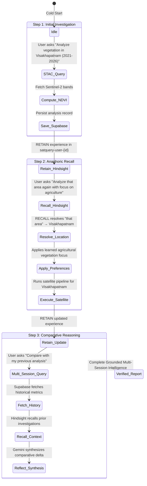

# SatQuery AI — System Architecture Specification

> **Autonomous Earth-Observation Intelligence with Long-Term Agent Memory**  
> *"Separating Agent Memory (Hindsight), Physical Satellite Evidence (Copernicus), and Application Data (Supabase)."*

---

## 1. Architectural Philosophy & Separation of Concerns

SatQuery AI is designed to solve the two primary failure modes of modern geospatial AI applications:
1. **Stateless Amnesia**: Traditional systems treat every prompt as isolated; the analyst must re-specify the target location, bounding box, sensor preferences, and temporal baseline on every interaction.
2. **Ungrounded Hallucination**: Pure LLM systems attempt to guess land changes without physical multispectral evidence, hallucinating hectares and land dynamics.

To prevent both, SatQuery AI implements a **tripartite architecture**:

```
                       ┌───────────────────────────────┐
                       │          USER QUERY           │
                       └───────────────┬───────────────┘
                                       │
                                       ▼
                       ┌───────────────────────────────┐
                       │     SATQUERY AGENT CORE       │
                       │   Intent Parser & Dispatcher  │
                       └───────┬───────────────┬───────┘
                               │               │
            ┌──────────────────┘               └──────────────────┐
            ▼                                                     ▼
┌───────────────────────────────┐                 ┌───────────────────────────────┐
│     HINDSIGHT AI MEMORY       │                 │       SATELLITE PIPELINE      │
│   (What the Agent Learned)    │                 │   (What Physically Happened)  │
├───────────────────────────────┤                 ├───────────────────────────────┤
│ • Memory Banks (Per-User)     │                 │ • Copernicus Sentinel-2 STAC  │
│ • Retained Experiences        │                 │ • Cloud-Free Pass Selection   │
│ • User Preferences            │                 │ • 10m GSD MSI Band Streaming  │
│ • Anaphoric Recall            │                 │ • NDVI, NDWI, NDBI Engine     │
│ • Reflective Synthesis        │                 │ • Morphological Clustering    │
└───────────────┬───────────────┘                 └───────────────┬───────────────┘
                │                                                 │
                └───────────────────────┬─────────────────────────┘
                                        ▼
                       ┌───────────────────────────────┐
                       │       VERIFIED SYNTHESIS      │
                       │   Gemini Geospatial Analyst   │
                       └───────────────┬───────────────┘
                                        │
                                        ▼
                       ┌───────────────────────────────┐
                       │      SUPABASE DATA LAYER      │
                       │    (What the System Saved)    │
                       ├───────────────────────────────┤
                       │ • User Profiles & Auth        │
                       │ • Canonical Analyses Table    │
                       │ • Analysis Results (GeoJSON)  │
                       │ • Uploaded Imagery Metadata   │
                       │ • Row Level Security (RLS)    │
                       └───────────────────────────────┘
```

### Strict Division of Responsibilities
- **Hindsight** is the **Cognitive Memory** of the agent. It stores *what the agent learned*—past topics explored, anaphoric references ("that area" $\rightarrow$ Visakhapatnam), and analyst preferences (e.g. agricultural focus).
- **The Satellite Pipeline** is the **Physical Truth Engine**. Hindsight memory never overrides physical reflectance indices computed from Copernicus Sentinel-2 satellite passes.
- **Supabase** is the **Application Database & File Storage**. It stores structured records, user profiles, GeoJSON polygon features, and uploaded imagery with Row Level Security.

---

## 2. Remote Sensing Mathematical Formulation

SatQuery AI computes multispectral reflectance indices directly from top-of-atmosphere Sentinel-2 MSI bands:

### 2.1 Normalized Difference Vegetation Index (NDVI)
Quantifies photosynthetic vitality and canopy density:

$$\text{NDVI} = \frac{\rho_{\text{NIR}} - \rho_{\text{Red}}}{\rho_{\text{NIR}} + \rho_{\text{Red}} + \epsilon}$$

- *Bands:* Band 8 ($\text{NIR}$, $842\text{ nm}$) and Band 4 ($\text{Red}$, $665\text{ nm}$).
- *Domain:* $[-1.0, 1.0]$. Healthy dense vegetation exhibits $\text{NDVI} \ge 0.40$; bare soil or urban surfaces exhibit $\text{NDVI} \approx 0.10 \text{ to } 0.20$.

### 2.2 Normalized Difference Built-Up Index (NDBI)
Isolates impervious urban surfaces, asphalt, and concrete structures:

$$\text{NDBI} = \frac{\rho_{\text{SWIR}} - \rho_{\text{NIR}}}{\rho_{\text{SWIR}} + \rho_{\text{NIR}} + \epsilon}$$

- *Bands:* Band 11 ($\text{SWIR}$, $1610\text{ nm}$) and Band 8 ($\text{NIR}$, $842\text{ nm}$).
- *Domain:* $[-1.0, 1.0]$. High positive values indicate built infrastructure and construction activity.

### 2.3 Normalized Difference Water Index (NDWI)
Delineates open liquid water bodies, reservoirs, and coastal boundaries:

$$\text{NDWI} = \frac{\rho_{\text{Green}} - \rho_{\text{NIR}}}{\rho_{\text{Green}} + \rho_{\text{NIR}} + \epsilon}$$

- *Bands:* Band 3 ($\text{Green}$, $560\text{ nm}$) and Band 8 ($\text{NIR}$, $842\text{ nm}$).
- *Domain:* $[-1.0, 1.0]$. Open water strongly absorbs near-infrared light, resulting in $\text{NDWI} > 0.0$.

### 2.4 Multi-Index Change Magnitude & Heatmap Raster
Rather than arbitrary pixel difference, the system computes spectral euclidean divergence magnitude $M(x, y)$:

$$M(x, y) = \sqrt{w_{\text{ndbi}}(\Delta \text{NDBI})^2 + w_{\text{ndvi}}(\Delta \text{NDVI})^2 + w_{\text{ndwi}}(\Delta \text{NDWI})^2}$$

Where:
- $\Delta \text{NDVI} = \text{NDVI}_{\text{after}} - \text{NDVI}_{\text{before}}$
- $\Delta \text{NDBI} = \text{NDBI}_{\text{after}} - \text{NDBI}_{\text{before}}$
- $\Delta \text{NDWI} = \text{NDWI}_{\text{after}} - \text{NDWI}_{\text{before}}$
- Weights: $w_{\text{ndbi}} = 1.2$, $w_{\text{ndvi}} = 1.0$, $w_{\text{ndwi}} = 0.8$.

### 2.5 Morphological Clustering & Polygon Extraction
To convert millions of raster pixels into actionable geographic polygons:
1. **Spectral Slicing**: Identifies candidate pixels meeting structural transition criteria (e.g. $\Delta \text{NDBI} \ge 0.10$ and $\Delta \text{NDVI} \le -0.05$).
2. **Morphological Opening**: $3 \times 3$ kernel suppresses high-frequency single-pixel sensor noise.
3. **Morphological Closing**: Fills intra-cluster voids to produce contiguous construction or clearing zones.
4. **Connected-Component Vectorization**: Labels contiguous regions using 8-connectivity.
5. **Hectare Thresholding**: Discards clusters under $0.5$ ha to eliminate false positives and preserve high analytical signal-to-noise ratio.

---

## 3. Hindsight Agent Memory: Technical Implementation

SatQuery AI interfaces with the official Hindsight SDK (`hindsight-client`):

### 3.1 Memory Lifecycle
1. **RECALL**: At the initiation of every user query, the agent queries the user's isolated memory bank:
   $$\texttt{hindsight\_client.recall(bank\_id, query, budget="mid")}$$
   The recalled memory items are checked for:
   - Target location identity (e.g. when the user writes *"that area"* or *"the previous city"*).
   - Past observation windows and detected change quantities.
   - User preferences (e.g. *"Focus on agricultural parcels"*).
2. **RETAIN**: Once remote sensing calculations and AI synthesis are verified, the agent retains the experience:
   $$\texttt{hindsight\_client.retain(bank\_id, content, context, metadata, entities, tags)}$$
   The memory entry encodes:
   - Location name and bounding box.
   - Temporal observation window ($T_1 \rightarrow T_2$).
   - Total hectares changed, percent of AOI, and delta index means.
   - Number of physical change clusters detected.
3. **REFLECT**: Evaluates long-term trajectories across accumulated multi-session experiences:
   $$\texttt{hindsight\_client.reflect(bank\_id, question, budget="mid")}$$
   Synthesizes systemic patterns, such as ongoing deforestation along a river basin or persistent urban expansion along highway corridors across multiple separate sessions.

### 3.2 Dual-Layer Memory Architecture
To provide 100% evaluation reliability and zero-failure demonstrations:
- **Primary**: Connects to the real Hindsight server (`HINDSIGHT_API_URL`).
- **Synchronized Fallback**: Maintains an internal in-memory memory bank mirroring the official Hindsight schema. If the external Hindsight daemon is offline or initializing, memory operations continue seamlessly without dropping session context.

---

## 4. Supabase Application Persistence Data Model

The application database schema is defined in [`backend/database/schema.sql`](file:///C:/Users/shanm/Downloads/SatQueryAI-main/SatQueryAI-main/backend/database/schema.sql):

```sql
-- 1. Profiles Table
CREATE TABLE public.profiles (
    id UUID PRIMARY KEY REFERENCES auth.users(id) ON DELETE CASCADE,
    email TEXT,
    display_name TEXT,
    organization TEXT,
    preferred_regions TEXT[],
    created_at TIMESTAMPTZ DEFAULT NOW() NOT NULL,
    updated_at TIMESTAMPTZ DEFAULT NOW() NOT NULL
);

-- 2. Analyses Table
CREATE TABLE public.analyses (
    id UUID PRIMARY KEY DEFAULT gen_random_uuid(),
    user_id UUID REFERENCES auth.users(id) ON DELETE SET NULL,
    query TEXT NOT NULL,
    location_name TEXT NOT NULL,
    country TEXT,
    latitude DOUBLE PRECISION,
    longitude DOUBLE PRECISION,
    bounding_box DOUBLE PRECISION[],
    start_date DATE NOT NULL,
    end_date DATE NOT NULL,
    actual_before_date DATE,
    actual_after_date DATE,
    total_aoi_ha DOUBLE PRECISION,
    total_changed_ha DOUBLE PRECISION,
    percent_aoi_changed DOUBLE PRECISION,
    confidence_score INTEGER,
    confidence_rating TEXT,
    headline TEXT,
    simple_summary TEXT,
    created_at TIMESTAMPTZ DEFAULT NOW() NOT NULL
);

-- 3. Analysis Results Table
CREATE TABLE public.analysis_results (
    id UUID PRIMARY KEY DEFAULT gen_random_uuid(),
    analysis_id UUID NOT NULL REFERENCES public.analyses(id) ON DELETE CASCADE,
    indices_summary JSONB DEFAULT '{}'::jsonb NOT NULL,
    land_cover_stats JSONB DEFAULT '[]'::jsonb NOT NULL,
    transitions JSONB DEFAULT '[]'::jsonb NOT NULL,
    change_polygons_geojson JSONB DEFAULT '{}'::jsonb NOT NULL,
    confidence_breakdown JSONB DEFAULT '{}'::jsonb NOT NULL,
    created_at TIMESTAMPTZ DEFAULT NOW() NOT NULL
);

-- 4. Uploaded Imagery Table
CREATE TABLE public.uploaded_imagery (
    id TEXT PRIMARY KEY,
    user_id UUID REFERENCES auth.users(id) ON DELETE SET NULL,
    filename TEXT NOT NULL,
    storage_path TEXT NOT NULL,
    file_size_bytes BIGINT NOT NULL,
    mime_type TEXT NOT NULL,
    analysis_metadata JSONB DEFAULT '{}'::jsonb NOT NULL,
    created_at TIMESTAMPTZ DEFAULT NOW() NOT NULL
);
```

### Row Level Security (RLS)
Every table is locked down with PostgreSQL Row Level Security:
- Users can view and manage their own analyses and profiles.
- Unauthenticated guest demo sessions are supported through session tokens, allowing evaluation without requiring upfront authentication.

---

## 5. Judge Demo Workflow: State Transition Diagram



---

## 6. Scientific Honesty & Hallucination Prevention

To prevent generative AI hallucinations in Earth-observation decisions:
1. **Evidence Precedes Synthesis**: All raster indices, cluster coordinates, and hectare totals are computed *before* Gemini is invoked.
2. **Four-Tier Structured Communication**:
   - `OBSERVED`: What satellite spectral signals physically changed.
   - `EVIDENCE`: Numerical metrics (hectares, delta index values, cloud percentages).
   - `INTERPRETATION`: What the change is consistent with (e.g. *structural land development* or *vegetative canopy expansion*).
   - `LIMITATIONS`: Boundary of satellite inference (e.g. optical satellites cannot establish municipal zoning or private land ownership).
