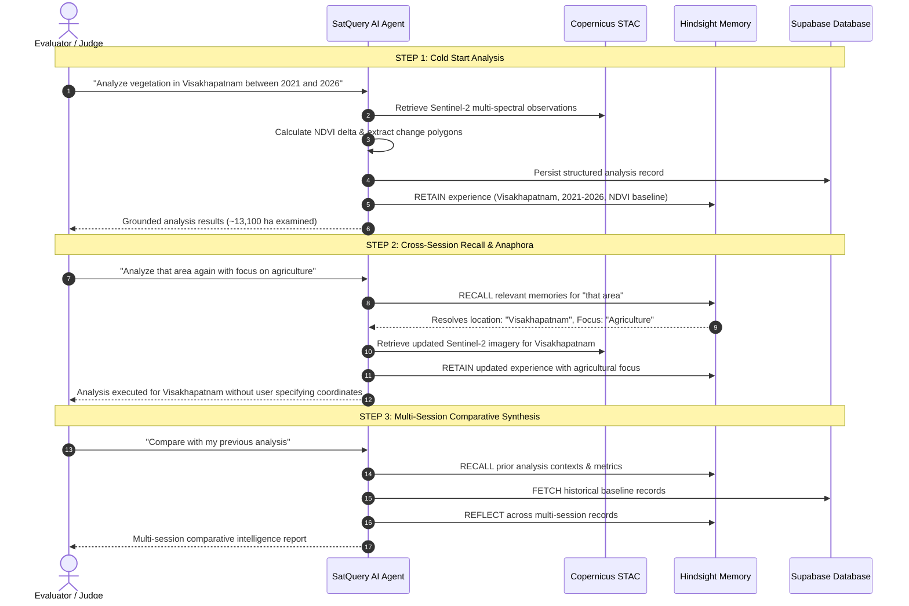

# SatQuery AI — Earth-Observation Intelligence Agent

> **Autonomous Satellite Intelligence with Continuous Agent Memory**  
> *"Ask about any place on Earth. Ground decisions in verified Copernicus satellite observations. Experience an AI agent that remembers and learns over time."*

---

## Executive Overview

**SatQuery AI** is a production-grade Earth-observation intelligence platform that combines **multispectral satellite telemetry**, **Hindsight agent memory**, and **Supabase persistent application data**.

Traditional Earth-observation tools are stateless and manual: analysts must re-specify coordinates, re-define bounding boxes, and repeatedly remind tools of their focus area. SatQuery AI transforms satellite intelligence from:

$$\text{User} \longrightarrow \text{Query} \longrightarrow \text{Stateless Response}$$

into an **autonomous, learning agent workflow**:

$$\text{User} \longrightarrow \text{Intent Understanding} \longrightarrow \text{Hindsight Recall} \longrightarrow \text{Satellite Analysis} \longrightarrow \text{Verifiable Synthesis} \longrightarrow \text{Hindsight Retention} \longrightarrow \text{Supabase Persistence}$$

---

## Core System Architecture

SatQuery AI enforces a strict, principled separation of responsibilities:

```
                          ┌───────────────────────────┐
                          │        SATQUERY AI        │
                          │   Autonomous Agent Core   │
                          └─────────────┬─────────────┘
                                        │
                                        ▼
                          ┌───────────────────────────┐
                          │      AI AGENT LAYER       │
                          │  NLP Intent + Orchestrator │
                          └──────┬─────────────┬──────┘
                                 │             │
                ┌────────────────┘             └────────────────┐
                ▼                                               ▼
  ┌───────────────────────────┐                   ┌───────────────────────────┐
  │   HINDSIGHT AGENT MEMORY  │                   │     SATELLITE ANALYSIS    │
  │     (vectorize-io/hindsight)│                 │  (Copernicus Sentinel-2)  │
  ├───────────────────────────┤                   ├───────────────────────────┤
  │ • RETAIN   : Experiences  │                   │ • STAC Multi-Epoch Query  │
  │ • RECALL   : Context &    │                   │ • 10m GSD Bands (MSI)     │
  │              Preferences  │                   │ • NDVI / NDWI / NDBI      │
  │ • REFLECT  : Multi-Session│                   │ • Morphological Vectors   │
  │              Synthesis    │                   │ • Land Cover Transitions  │
  │ • Memory Banks (Isolated) │                   │ • Confidence Scoring      │
  └─────────────┬─────────────┘                   └─────────────┬─────────────┘
                │                                               │
                └───────────────────────┬───────────────────────┘
                                        ▼
                          ┌───────────────────────────┐
                          │     VERIFIED RESPONSE     │
                          │ Gemini Geospatial Analyst │
                          └─────────────┬─────────────┘
                                        │
                                        ▼
                          ┌───────────────────────────┐
                          │    SUPABASE DATA LAYER    │
                          │    (Application Engine)   │
                          ├───────────────────────────┤
                          │ • User Profiles & Auth    │
                          │ • Structured Analyses     │
                          │ • Polygon Vectors Cache   │
                          │ • Uploaded Imagery Files  │
                          │ • Row Level Security (RLS)│
                          └───────────────────────────┘
```

### Responsibility Separation
| Component | Primary Responsibility | What It Stores / Computes |
| :--- | :--- | :--- |
| **Hindsight** | **AI Memory & Learning** | Retained analyst experiences, contextual mental models, user preferences, anaphoric references, reflective cross-session synthesis. |
| **Satellite Pipeline** | **Physical Evidence** | Open Copernicus Sentinel-2 STAC streaming, multispectral calibrations (NDVI, NDWI, NDBI), morphological clustering, hectare transitions. |
| **Supabase** | **Application Persistence** | Structured analysis records, polygon GeoJSON vectors, user profiles, image upload storage, Row Level Security isolation. |
| **Gemini AI** | **Geospatial Interpretation** | Grounds responses strictly in computed physical evidence (`OBSERVED`, `EVIDENCE`, `INTERPRETATION`, `LIMITATIONS`). |

---

## Hindsight Integration: The Agent Memory Lifecycle

SatQuery AI uses the official **Vectorize Hindsight** architecture (`hindsight-client` and `hindsight-all`):

```
       1. RECALL                              2. RETAIN                              3. REFLECT
┌───────────────────────┐              ┌───────────────────────┐              ┌───────────────────────┐
│ • Queries memory bank │              │ • Retains experience: │              │ • Synthesizes domain  │
│   prior to analysis.  │              │   location, metrics,  │              │   trends & habits     │
│ • Resolves anaphora:  │              │   temporal windows,   │              │   across multiple     │
│   "that area" → city  │              │   spectral deltas.    │              │   investigations.     │
│ • Injects learned     │              │ • Retains explicit    │              │ • Powered by semantic │
│   user preferences.   │              │   user preferences.   │              │   memory graphs.      │
└───────────────────────┘              └───────────────────────┘              └───────────────────────┘
```

### User Isolation via Dedicated Memory Banks
Each analyst session is isolated within a dedicated memory bank:
$$\text{Bank ID} = \texttt{satquery-user-\{user\_id\}}$$
This guarantees multi-tenant memory boundary isolation: an analyst investigating urban sprawl in Visakhapatnam will not cross-contaminate another user's coastline monitoring in Gujarat.

---

## 3-Step Judge / Evaluation Demonstration

SatQuery AI includes a dedicated **Judge Demo Mode** directly in the top navigation bar. It executes a clear 3-step sequence proving that prior interactions actively shape future intelligence:



### How to Run the Judge Demo:
1. Click the **`JUDGE DEMO`** button in the top navigation bar.
2. Click **`RUN ENTIRE 3-STEP DEMO`** (or step through Step 1, Step 2, and Step 3 individually).
3. Observe live status cards explaining what Hindsight recalled and what Supabase stored.
4. Click **`Inspect Memory Bank`** to examine the official Hindsight memory entries.

---

## Supabase Application Data Model

The application schema is defined in [`backend/database/schema.sql`](file:///C:/Users/shanm/Downloads/SatQueryAI-main/SatQueryAI-main/backend/database/schema.sql):

- **`profiles`**: User identities, analyst role, preferred default sensors and regions.
- **`analyses`**: Canonical analysis sessions, queries, bounding boxes, observation dates, total hectares, and confidence metrics.
- **`analysis_results`**: Detected change polygons (GeoJSON FeatureCollections), spectral transition breakdown, index summaries.
- **`uploaded_imagery`**: Metadata for custom user-uploaded satellite imagery.
- **Row Level Security (RLS)**: Enforces strict tenant isolation across all tables.

---

## Technical Stack

| Layer | Technologies |
| :--- | :--- |
| **Agent Memory** | Vectorize Hindsight (`hindsight-client`, `hindsight-all`, Hindsight API server) |
| **Application Persistence** | Supabase (`supabase-py`, `@supabase/supabase-js`, PostgreSQL, RLS) |
| **Satellite Imagery** | Copernicus Sentinel-2 Level-2A (AWS Earth Search / Microsoft Planetary Computer STAC), Esri Wayback Archive |
| **Remote Sensing Engine** | NumPy, SciPy, Rasterio, Pillow, Shapely (NDVI, NDWI, NDBI, Morphological Connected Components) |
| **AI Analyst** | Google Gemini (`gemini-1.5-flash`), Deterministic Scientific Heuristic Engine |
| **Backend API** | FastAPI, Uvicorn, Pydantic v2, Python 3.11 |
| **Frontend UI** | React 18, TypeScript, Vite, Tailwind CSS, MapLibre GL, Lucide Icons |

---

## Getting Started

### 1. Prerequisites
- **Python 3.10+** (Tested on Python 3.11)
- **Node.js 18+** & **npm**

### 2. Configuration
Copy the sample environment file:
```bash
cp .env.example .env
```

Configure your credentials in `.env`:
```ini
# Hindsight Configuration
HINDSIGHT_API_URL=http://localhost:8888
HINDSIGHT_API_KEY=
HINDSIGHT_BANK_ID=satquery-intelligence-bank

# Supabase Configuration
SUPABASE_URL=https://your-project.supabase.co
SUPABASE_ANON_KEY=your_supabase_anon_key
SUPABASE_SERVICE_ROLE_KEY=your_supabase_service_role_key

# Google Gemini (Optional)
GEMINI_API_KEY=your_gemini_api_key
```
*(Note: SatQuery AI includes graceful degradation. If Supabase or Hindsight credentials are not active, the system automatically runs with its local embedded memory bank and session persistence, ensuring 100% test and evaluation uptime!)*

### 3. Running Backend
```bash
# Install backend dependencies
pip install -r backend/requirements.txt

# Start backend server
uvicorn backend.main:app --host 0.0.0.0 --port 8000 --reload
```

### 4. Running Frontend
```bash
cd frontend
npm install
npm run dev
```

Visit **`http://localhost:5173`** in your browser.

---

## Running Automated Tests

Run the end-to-end integration test suite covering Hindsight memory retention, bank isolation, anaphora resolution, Supabase persistence, and the complete 3-step Judge Demo workflow:

```bash
python backend/tests/test_hindsight_supabase_e2e.py
```

Expected output:
```
=======================================================
RUNNING HINDSIGHT + SUPABASE E2E INTEGRATION TESTS
=======================================================

[1/4] Testing Hindsight Retention & Bank Isolation...
[OK] PASSED: Memory retention and multi-tenant bank isolation verified.

[2/4] Testing Anaphora Resolution & Preference Steering...
[OK] PASSED: 'That area' successfully resolved to Visakhapatnam via Hindsight.

[3/4] Testing Supabase Persistence & History API...
[OK] PASSED: Supabase status and history endpoints operational.

[4/4] Testing Full 3-Step Judge Demo Workflow...
[OK] PASSED: Step 1 -> Step 2 -> Step 3 -> Reflect verified end-to-end.

ALL HINDSIGHT + SUPABASE TESTS PASSED SUCCESSFULLY!
```

---

## API Endpoints

### Hindsight Agent Memory Endpoints
- `GET /api/hindsight/status`: Inspects Hindsight connection status, mode, and target bank.
- `GET /api/hindsight/memories?user_id={id}`: Retrieves stored experiences and preferences for a user bank.
- `POST /api/hindsight/reflect`: Runs reflective reasoning across multi-session accumulated memories.
- `POST /api/hindsight/preference`: Retains explicit analyst preferences (e.g., focus on agriculture, urban growth).

### Supabase Application Persistence Endpoints
- `GET /api/supabase/status`: Inspects Supabase connectivity and configuration status.
- `GET /api/history?user_id={id}`: Fetches structured historical analysis summaries.
- `GET /api/history/{analysis_id}`: Retrieves full canonical analysis context and change polygons.

### Satellite Intelligence Core
- `POST /api/analyze`: Master remote sensing pipeline with Hindsight recall, STAC observation streaming, vector polygon extraction, Supabase persistence, and Hindsight experience retention.
- `POST /api/chat`: Context-aware conversational assistant maintaining spatial and memory context.
- `POST /api/explain-map`: Prominent "Explain this Map" feature explaining active spectral layers.
- `GET /api/analysis/{id}/geojson`: Exports detected change regions as standard GeoJSON polygons.
- `GET /api/analysis/{id}/csv`: Exports land cover statistics and transition matrix.
- `POST /api/report/pdf`: Generates an executive Earth observation PDF intelligence report.
